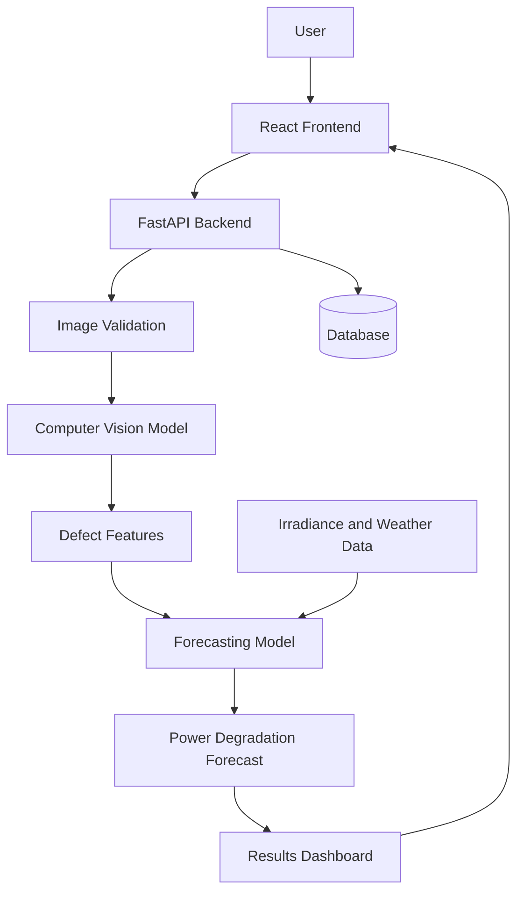

# Solar Panel Defect & Output Degradation Forecaster

## 1. Project Overview

The project aims to identify defects in solar panels using
drone-based infrared/thermal imagery and forecast potential
power-output degradation.

The system will combine computer vision, machine learning,
environmental data and a web-based dashboard to support
solar panel maintenance decisions.

## 2. Technology Stack

| Component | Technology | Purpose |
|---|---|---|
| Frontend | React + Vite | User interface |
| Backend | FastAPI | REST API services |
| Computer Vision | PyTorch | Image analysis |
| Defect Segmentation | AU-Net | Proposed defect localization |
| Forecasting | XGBoost | Power degradation prediction |
| Data Processing | NumPy, Pandas, OpenCV | Data preparation |
| Database | To be finalized | Store scan results |
| Experimentation | Google Colab | Model training |
| Version Control | Git + GitHub | Collaboration |
| Deployment | To be finalized | Cloud hosting |

## 3. High-Level System Architecture

## 4. Computer Vision Pipeline

The computer vision component will analyze infrared/thermal
images to identify possible solar panel defects.

Proposed workflow:

1. Receive infrared/thermal image.
2. Validate the uploaded image.
3. Preprocess the image.
4. Perform defect classification.
5. Investigate AU-Net segmentation using suitable
   pixel-level annotations.
6. Extract relevant defect features.

### 4.1 Image Classification

The current RaptorMaps dataset provides image-level
anomaly labels.

A computer vision classification model will be
developed to identify supported anomaly categories.

### 4.2 Defect Segmentation

Attention U-Net (AU-Net) is proposed for pixel-level
defect segmentation.

A suitable dataset containing pixel-level segmentation
masks will be required before training this model.

## 5. Forecasting Pipeline

The forecasting component will combine information
from multiple sources:

- Defect-related features.
- Solar irradiance.
- Weather conditions.
- Historical power-generation data.

XGBoost regression will be investigated to estimate
power-output degradation.

The final forecasting target and prediction horizon
will be defined after selecting the appropriate dataset.

## 6. Backend Architecture

The backend will use FastAPI with modular components.

| Component | Responsibility |
|---|---|
| API Routes | Handle HTTP requests |
| Schemas | Validate request and response data |
| Services | Implement application logic |
| ML | Load models and perform inference |
| Core | Application configuration |
| Tests | Automated backend testing |

The modular structure will make the backend easier
to maintain, test and extend.

## 7. Deployment Architecture

The proposed deployment will contain:

- React frontend hosted on a cloud platform.
- FastAPI backend hosted as a separate service.
- Managed database service.
- Trained machine learning models loaded by the backend.
- GitHub Actions for automated testing and CI/CD.

The final cloud providers will be selected after
evaluating deployment requirements and available
free-tier limitations.

## 8. Current Implementation Status

### 8.1 Completed

- GitHub repository setup.
- Initial project folder structure.
- Python virtual environment.
- FastAPI application.
- Health-check endpoint.
- Modular health API routing.
- Pydantic response schema.
- Automated health-check test.
- Initial system architecture documentation.

### 8.2 Planned

- Image upload API.
- Image preprocessing pipeline.
- Computer vision classification model.
- AU-Net segmentation.
- XGBoost forecasting.
- Database integration.
- React frontend and dashboard.
- Cloud deployment.
- CI/CD automation.

## 9. Dataset Constraints

The current RaptorMaps InfraredSolarModules dataset
contains infrared images with image-level anomaly labels.

Pixel-level segmentation masks have not been confirmed
in the current dataset.

Therefore, suitable annotated data will be required
for AU-Net segmentation.

Irradiance, weather and historical power-generation
data must also be finalized before regression training.

The current dataset will first be used to establish
a reliable image-classification pipeline.

## 10. Development Plan

The project will be developed incrementally through
the following stages:

1. Backend foundation and API development.
2. Dataset preparation and preprocessing.
3. Computer vision model development.
4. Defect classification and evaluation.
5. Segmentation feasibility and implementation.
6. Irradiance and weather data integration.
7. XGBoost forecasting model development.
8. Frontend and database integration.
9. Cloud deployment and CI/CD.
10. Final testing and documentation.

## 11. Testing and Evaluation

Different components will use suitable evaluation methods.

| Component | Evaluation Metrics |
|---|---|
| Image Classification | Accuracy, Precision, Recall, F1-score |
| Image Segmentation | IoU, Dice Score |
| Forecasting | MAE, RMSE, MAPE |
| Backend APIs | Automated Functional Tests |
| Full Application | Integration and End-to-End Tests |

Evaluation metrics will be calculated using actual
experimental results. No performance figures will
be assumed before model evaluation.

## 12. Development Principle

Each component will be implemented, tested and documented
before integration into the complete system.

The project will follow an incremental development
approach with regular GitHub commits, code reviews,
testing and documentation.

Completed features will be distinguished from proposed
or planned features throughout development.